

  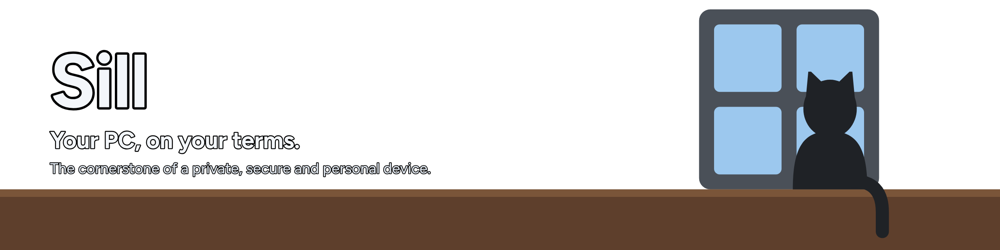

  
  
  

  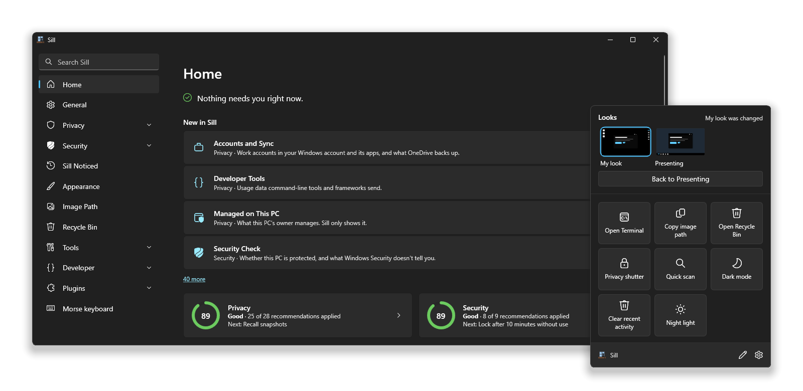

  <b>Home</b> shows what needs you, what's new, your scores and what Sill noticed. The <b>quick menu</b> opens from the tray icon or <kbd>Ctrl</kbd>+<kbd>Shift</kbd>+<kbd>Alt</kbd>+<kbd>Q</kbd>.

## 🛡️ Privacy and security, scored

Sill scores how well your account is set up and fixes it in one click. It only changes settings of your own account,
needs no administrator, and nothing it reads leaves your PC.

<table>
  <tr>
    <td width="50%">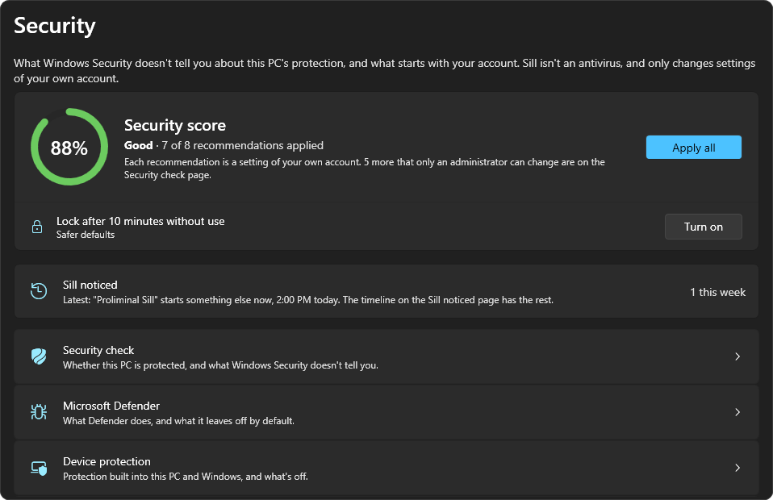</td>
    <td width="50%">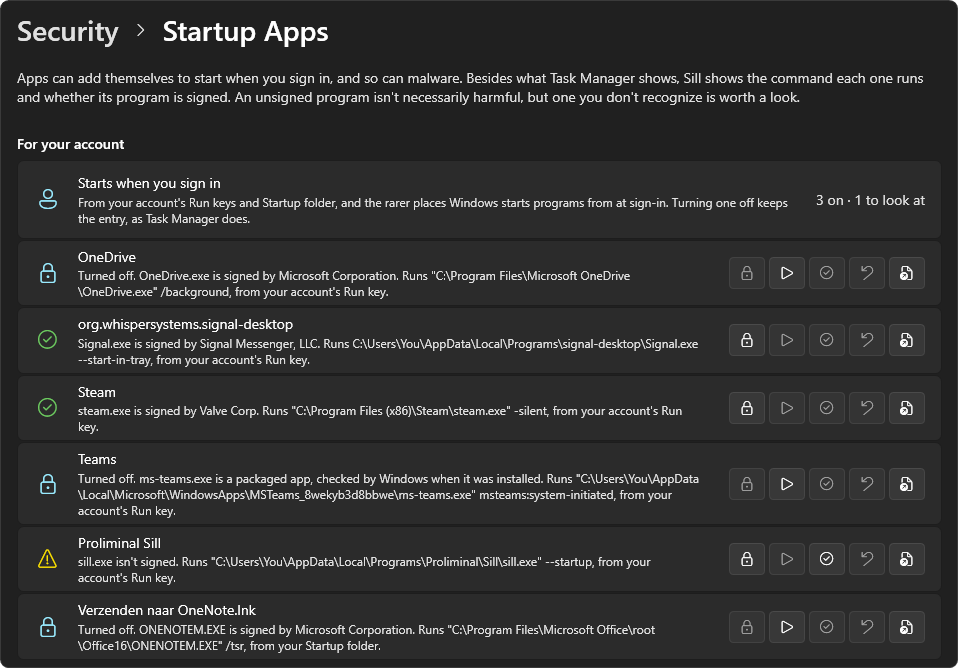</td>
  </tr>
  <tr>
    <td><b>Security score</b> What Windows Security doesn't tell you, from Defender's defaults to drive encryption, with <i>Apply all</i>.</td>
    <td><b>Startup apps</b> Everything that starts when you sign in, the command it runs, and whether it's signed.</td>
  </tr>
  <tr>
    <td width="50%">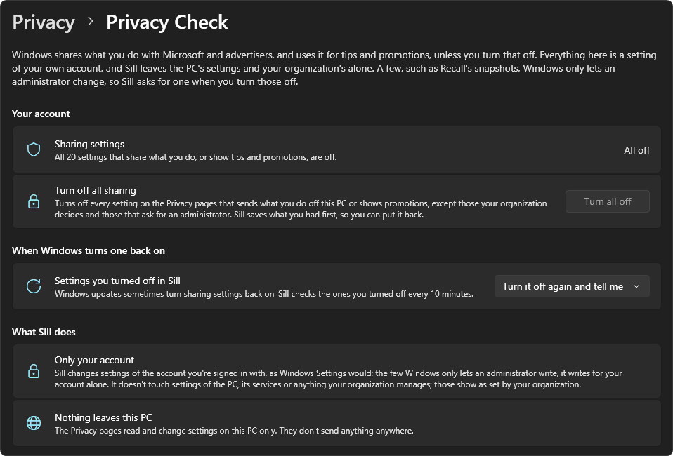</td>
    <td width="50%">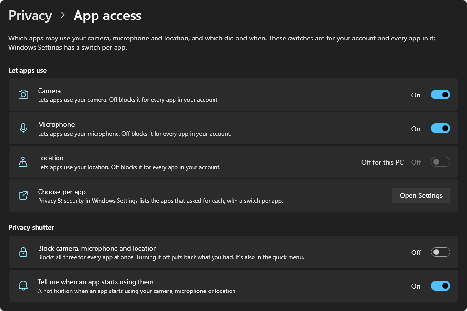</td>
  </tr>
  <tr>
    <td><b>Privacy check</b> Turns off every setting that shares what you do, and turns it off again when a Windows update turns it back on.</td>
    <td><b>App access</b> Which apps may use your camera, microphone and location, which did, and a shutter that blocks all three.</td>
  </tr>
</table>

**Sill noticed** keeps a timeline of what changed on its own: sharing that came back on, protection that turned off,
apps that added themselves to startup, and settings Sill applied that something else changed back.

## 🔑 A password manager that stays on your PC

Your logins in one encrypted file on this PC, never synced or sent anywhere. Unlock it with a master password or
Windows Hello, optionally on a secure desktop that other apps can't watch. Press
<kbd>Ctrl</kbd>+<kbd>Shift</kbd>+<kbd>Alt</kbd>+<kbd>L</kbd> over any app to fill in a login or copy it; copies stay out
of clipboard history and are cleared after a while. It shows weak and reused passwords, makes two-factor codes, and
imports from your browser, Bitwarden, 1Password and KeePass. From a terminal, `sill pass get <name> --clip` copies a
password once you allow it.

## 🎨 Switch how Windows looks in one click

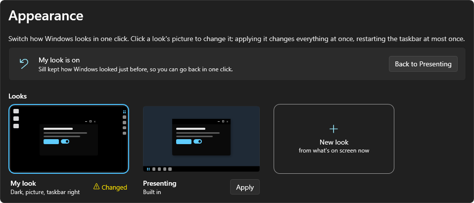

Save your configuration as a **look**: dark mode, all black, transparency, wallpaper and a compact taskbar. 
Switch between looks from the quick menu.

## ⌨️ Made for the command line

<table>
  <tr>
    <td width="50%">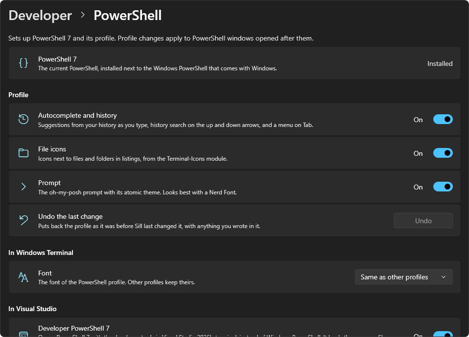</td>
    <td width="50%">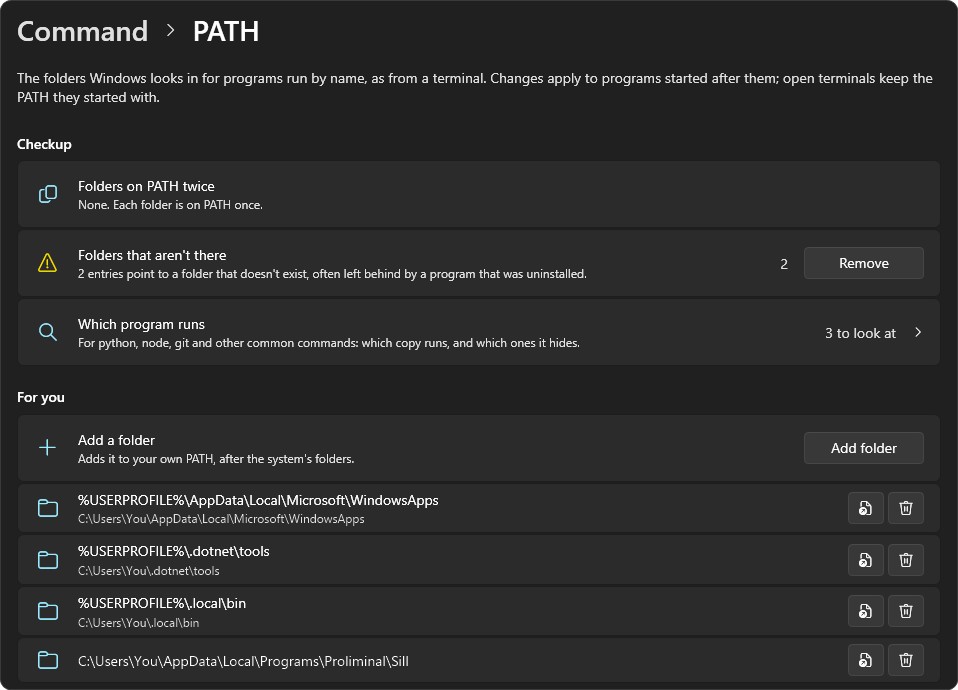</td>
  </tr>
  <tr>
    <td><b>PowerShell</b> One-click PowerShell 7 with autocomplete, file icons, an oh-my-posh prompt and a Visual Studio dev shell.</td>
    <td><b>PATH</b> Edit your PATH and the system's, and find folders that are gone, listed twice or hide another program.</td>
  </tr>
  <tr>
    <td width="50%">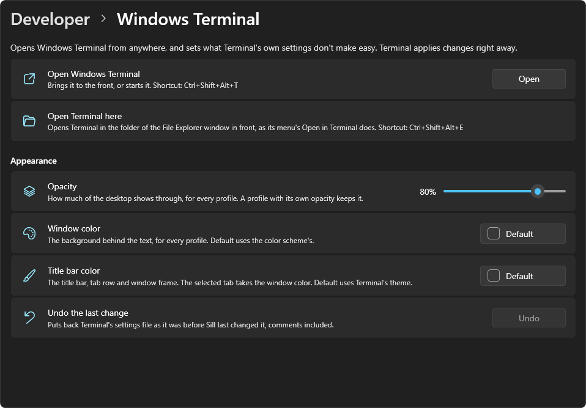</td>
    <td width="50%">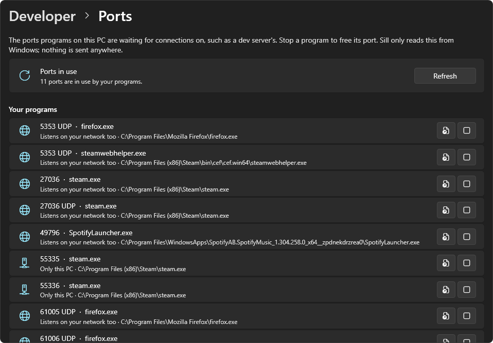</td>
  </tr>
  <tr>
    <td><b>Windows Terminal</b> Bring Terminal to the front from anywhere, open it in the folder you're in, and set its opacity and colors.</td>
    <td><b>Ports</b> See which program is on a port, and stop it to free the port.</td>
  </tr>
</table>

 

## 🧰 Developer tools

Small tools for code and data, all working on your PC only: **Encoding** (Base64, URL, HTML, Punycode and more),
**Hashing** of text and files, **Generators** for GUIDs, passwords and keys, **Date and time**, **Numbers** in every
base, **Color** formats and contrast, **Text** case and cleanup, **Format** for JSON, XML and YAML, **Regex** with its
matches and groups, and **JWT** decoding. Most also work on what's on the clipboard, from the quick menu.

Sill can also opt you out of the usage data that tools like the .NET SDK, PowerShell, the Azure CLI and Next.js send.

## ⚡ Everyday shortcuts

<table>
  <tr>
    <td width="50%">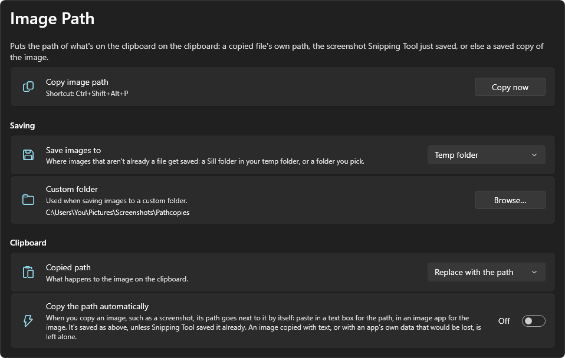</td>
    <td width="50%">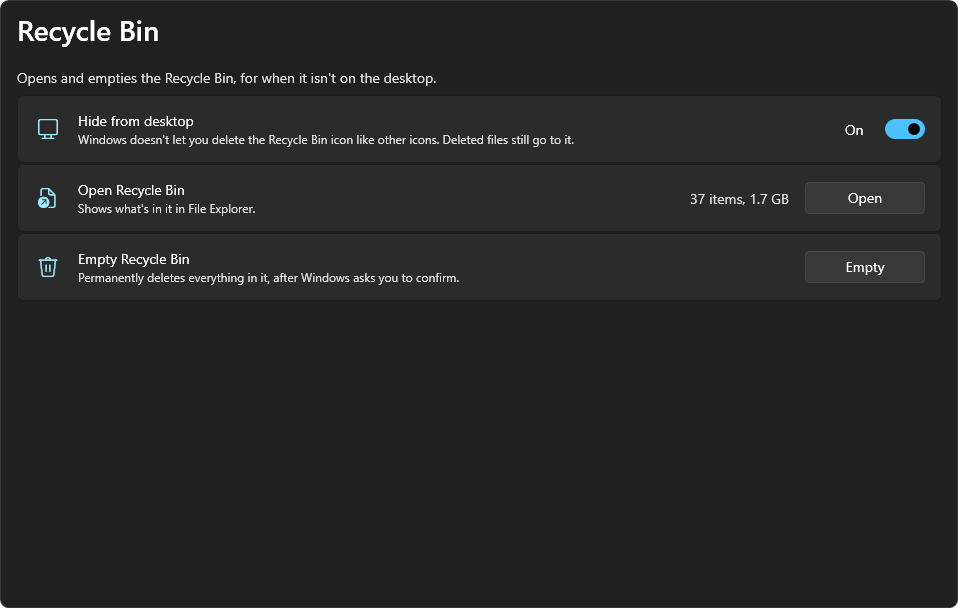</td>
  </tr>
  <tr>
    <td><b>Image path</b> Turns the image or file on your clipboard into its path, ready to paste into a terminal or a chat.</td>
    <td><b>Recycle Bin</b> Open or empty it without the desktop icon, so you can hide that.</td>
  </tr>
</table>

Every shortcut can be changed, and every quick action, and every look, can get one of its own. Moving to another PC?
Export your setup to a file, looks included, and import it there; you see every change before anything is changed.
From a terminal, `sill setup export|import <file>` does the same, `sill setting list|get|set` reaches every option on
Sill's pages, and `sill look apply <name>` switches looks.

## 🧩 Write your own plugins

<table>
  <tr>
    <td width="50%">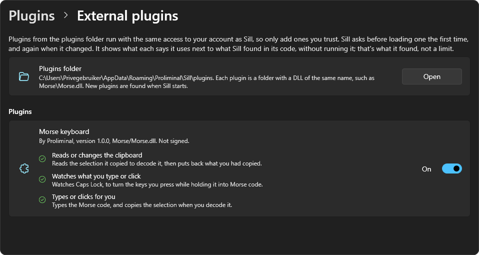</td>
    <td width="50%">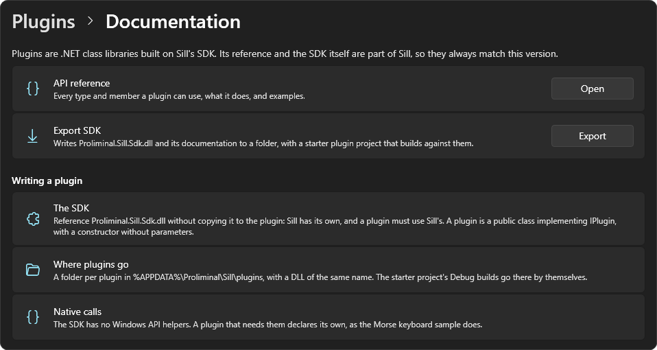</td>
  </tr>
  <tr>
    <td><b>Plugins you trust</b> Sill asks before it loads a new or changed plugin, and shows what Sill found it uses in its code, like this Morse keyboard sample.</td>
    <td><b>Everything you need is in Sill</b> The API reference lists every type and member; <i>Export SDK</i> writes the SDK with a starter project.</td>
  </tr>
</table>

Plugins are .NET class libraries built on the SDK in this repository. A plugin describes its page and Sill draws it,
so it looks like the rest of Sill and is found by search. Its options can be changed with `sill setting` and go along
in an exported setup; secrets, such as API tokens, are kept encrypted apart from them and never exported. It can add
quick actions, which users can give a shortcut, popups that open over any app as the password picker does, sections at
the top of the quick menu, and recommendations to the privacy or security score. It can also note what it did in Sill
noticed, and show on Home what keeps it from working. Each plugin
is loaded apart from Sill and from other plugins: it gets the SDK and .NET from Sill, and brings everything else
itself. Issues and pull requests for the SDK are welcome.
